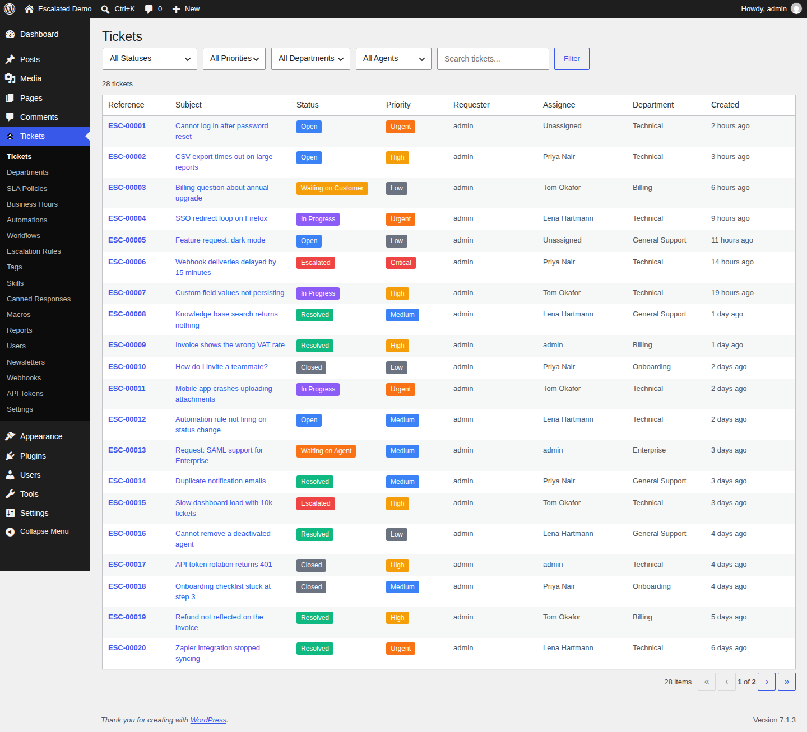
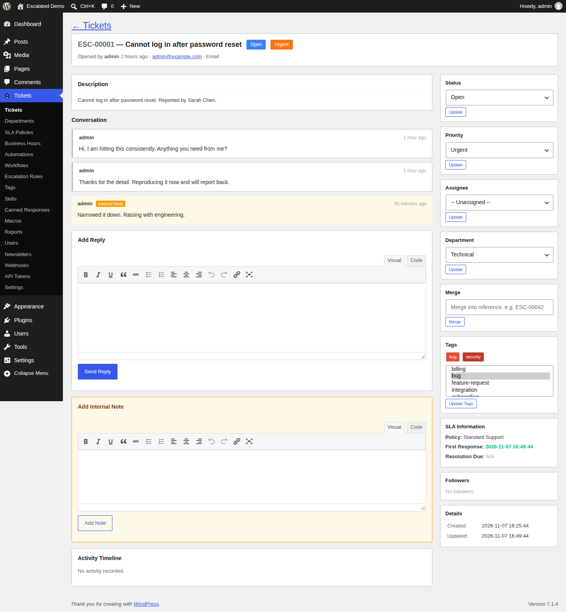
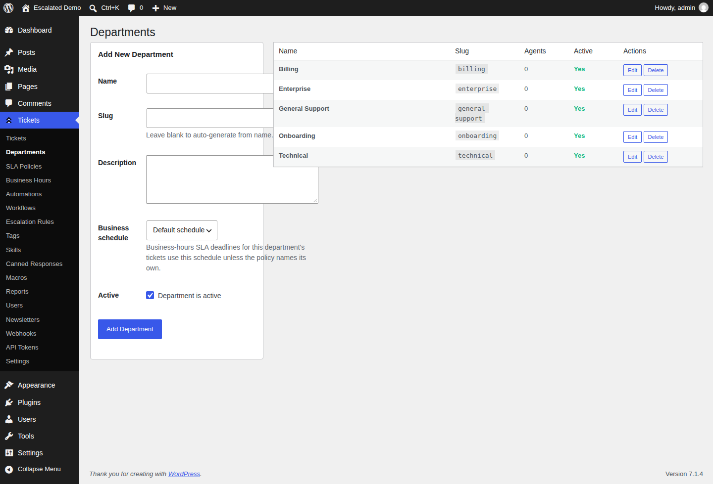
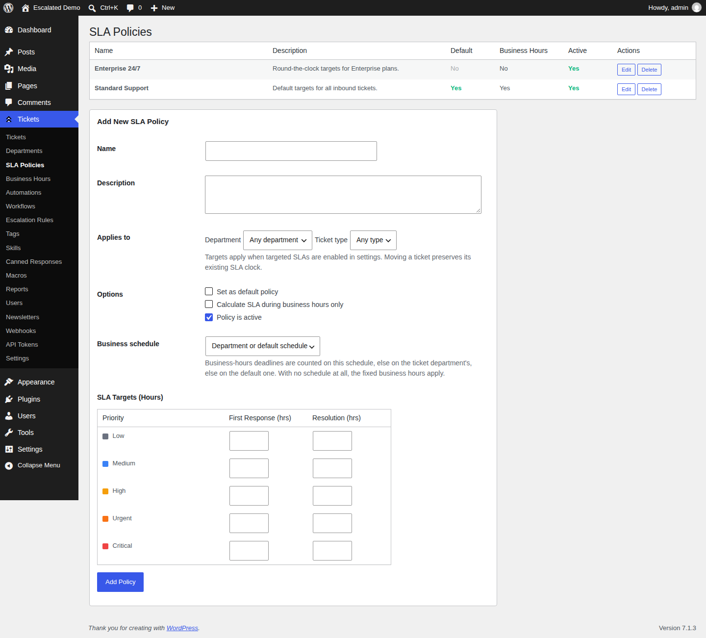
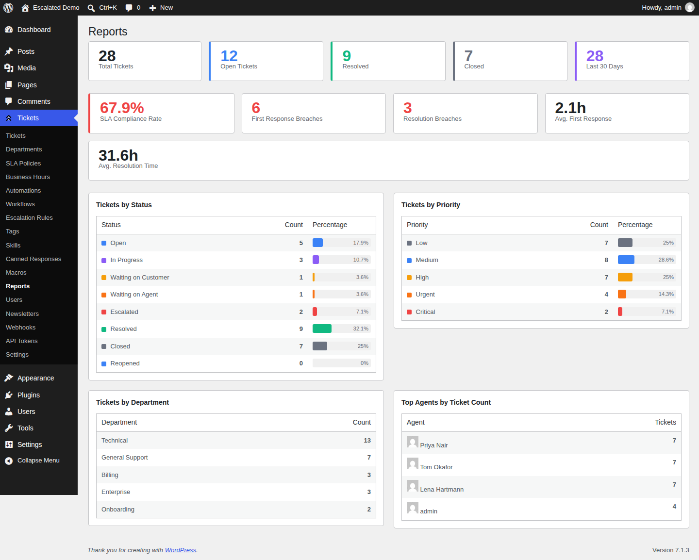
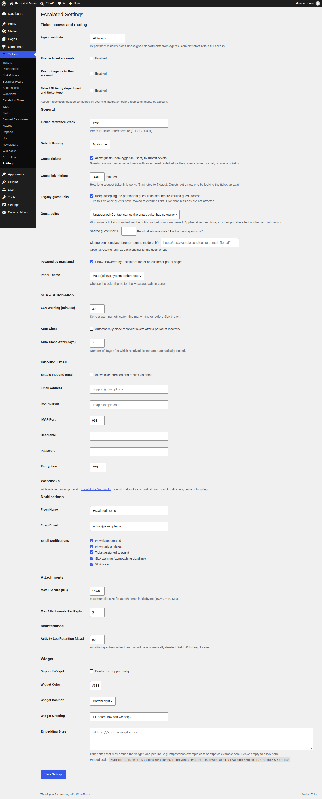
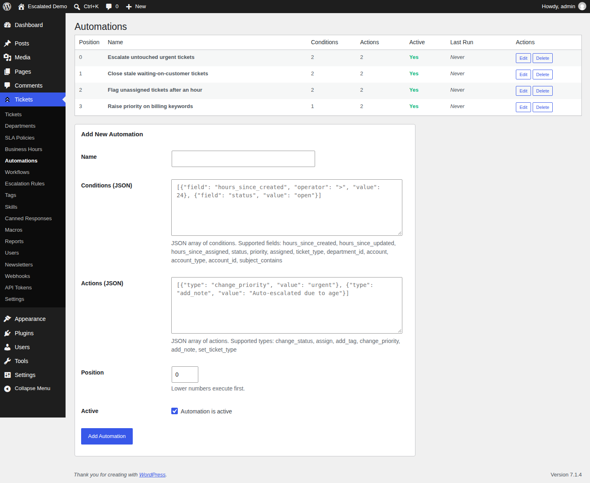
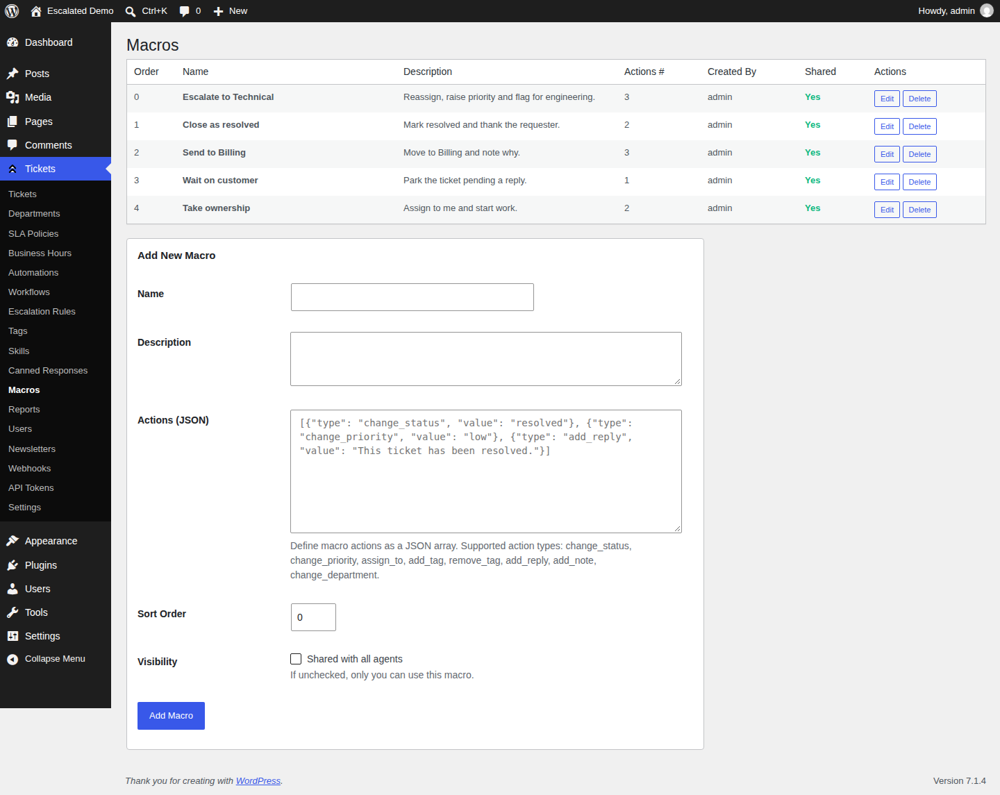

# Screenshots

## Screenshots

| Ticket List | Ticket Detail |
|:-----------:|:-------------:|
|  |  |

| Departments | SLA Policies |
|:-----------:|:------------:|
|  |  |

| Reports | Settings |
|:-------:|:--------:|
|  |  |

| Automations | Macros |
|:-----------:|:------:|
|  |  |

> Screenshots are auto-generated via Playwright on every release. See `.github/workflows/screenshots.yml`.
